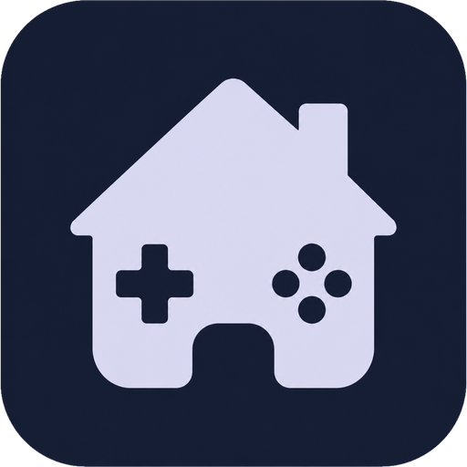
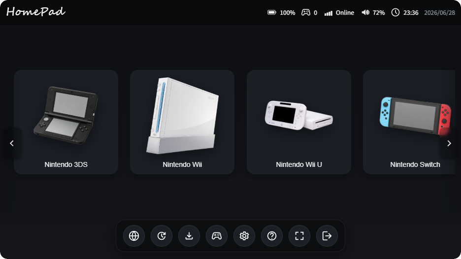

<div align="center">



# HomePad

[English](README.md) | [日本語](README.ja.md)

**ゲーム機のような操作感で使える、Nintendo エミュレーター向けランチャー。**

DS・DSi・3DS・Wii・Wii U・Switch のエミュレーターの起動、ダウンロード、設定をひとつの画面で。
ウィンドウ枠のないダッシュボードを、マウスやコントローラーで操作できます。




</div>

---

## ✨ 主な機能

### 🎛️ ホーム画面と起動

- **ゲーム機風のダッシュボード** — 横にスクロールするタイルから、各エミュレーターをクリックして起動できます。
- **2種類の起動モード** — エミュレーターを通常起動するか、ゲーム機の **HOMEメニュー／システムメニュー** を直接起動するかを選べます。
- **Switch の HOMEメニュー起動** — HOMEメニュー用の起動オプションがないエミュレーターでも、インストール済みのファームウェアから HOMEメニュー（qlaunch）を自動で探して起動します。
- **右クリックメニュー** — タイルごとに HOMEメニューやエミュレーターを起動したり、エミュレーター・NAND・MLC のフォルダーを開いたりできます。
- **コンソールモード** — 全画面表示とゲームパッド操作に対応し、画面に操作ガイドを表示します。操作対象を開いている画面に限定し、背後の画面への誤操作を防ぎます。
- **起動画面** — アプリの起動中に HomePad のスプラッシュ画面を表示します。

### 📥 ダウンロードとインストール

- **内蔵ダウンローダー** — 各エミュレーターの最新リリースをダウンロードできます。進捗表示とキャンセルに対応しています。
- **Installer タブ** — エミュレーターの動作に必要なファイルを設定できます。
  - **Nintendo Switch** — **ファームウェア**（NCA フォルダー）と **復号キー**（`prod.keys`／`title.keys`）をエミュレーターのデータフォルダーへインストールします。キーの有無、ファームウェアのファイル数、**HOMEメニュー** を起動できるかを表示します。
  - **Nintendo 3DS** — **システムファイル**（`aes_keys.txt`、`seeddb.bin`、`shared_font.bin`）をエミュレーターの `sysdata` フォルダーへインストールします。
  - **データフォルダーの自動検出** — エミュレーターの隣にあるポータブル用の `user/` フォルダー、続いて `%APPDATA%` 内の候補を探します。複数の候補がある場合は検索ボタンで順に切り替えられ、インストール済みのファイルも確認できます。

### 🧩 ゲーム機ごとの設定

- **エミュレーターフォルダーの指定** — ゲーム機ごとに使用するエミュレーターのフォルダーを指定できます。ゲーム機のアイコンを表示し、存在しないパスは赤色で示します。
- **melonDS（DS／DSi）** — BIOS、ファームウェア、NAND のパスを管理し、melonDS の設定ファイルへ直接反映します。
- **3DS の NAND／Cemu（Wii U）の MLC** — 専用の設定カードにフォルダーのパスを表示します。HOMEメニュー用ファイルの有無と、検出した **リージョン**・**タイトルID** も確認できます。

### 🎮 コントローラーとステータス

- **コントローラー対応** — 接続済みのゲームパッドとプレイヤー番号を表示し、振動テストも実行できます。コンソールモードではゲームパッドで画面を操作できます。
- **ステータスバー** — バッテリー、Wi-Fi、音量、時計を表示します。

### 🎨 表示と便利な機能

- **テーマ** — ダーク／ライトを選べます。アイコンの色は白／黒から選択でき、ゲーム機ごとに個別設定することもできます。
- **Discord Rich Presence** — 閲覧中・プレイ中のゲーム機を Discord に表示し、最新リリースへのリンクも掲載します。
- **閉じたときのトレイ収納** — デフォルトでは Exit ボタンやウィンドウを閉じる操作で HomePad をシステムトレイに収納し、Discord Rich Presence を維持します。完全終了する動作に変える場合は、**Settings → General → When closing HomePad** で **Exit app** を選んで保存してください。トレイメニューの **Quit** は、設定に関係なく完全終了します。
- **アップデート確認** — ツールバーから GitHub の最新リリースを確認できます。更新がある場合は、リリースノート付きのダイアログを表示します。

## 🕹️ 対応するゲーム機とエミュレーター

| ゲーム機 | エミュレーター |
|----------|----------------|
| Nintendo DS／DSi | melonDS |
| Nintendo 3DS | Borked3DS、Azahar、AzaharPlus、Mandarine |
| Nintendo Wii | Dolphin |
| Nintendo Wii U | Cemu |
| Nintendo Switch | Eden、Citron-Neo、Sudachi、Suyu |

## 🚀 使い始める

[リリースページ](https://github.com/Riyoway/HomePad/releases)から、最新の **インストーラー版** または **ポータブル版** をダウンロードしてください。
ソースコードからビルドすることもできます。主な対応プラットフォームは Windows です。

### ソースコードからビルドする

**必要な環境：** [Node.js](https://nodejs.org)、[Rust](https://www.rust-lang.org/tools/install)、および [Tauri の前提条件](https://v2.tauri.app/start/prerequisites/)。

リポジトリのルートで、以下を実行します。

```bash
npm install
npm run tauri dev      # 開発モードで起動
npm run tauri build    # 配布用インストーラーと実行ファイルをビルド
```

## 🛠️ 使用技術

[Tauri 2](https://tauri.app)（Rust）+ TypeScript + [Vite](https://vite.dev)。

## ⚠️ 免責事項

HomePad は独立したランチャーであり、任天堂およびその他の企業とは提携しておらず、これらの企業による承認も受けていません。
エミュレーター、ゲーム、BIOS、ファームウェア、復号キーは同梱・配布していません。これらのファイルは、利用する正当な権利がある場合にのみ使用してください。
すべての商標は、それぞれの権利者に帰属します。
